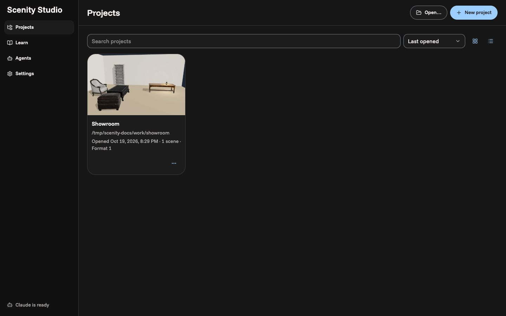
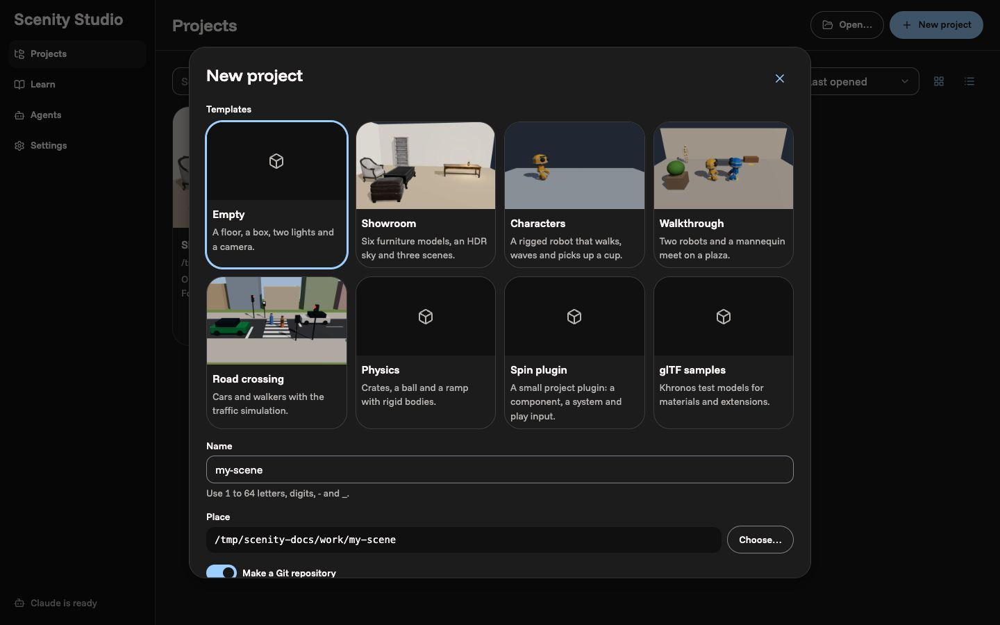
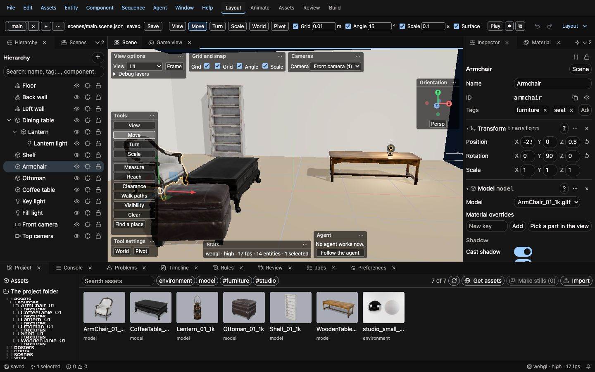
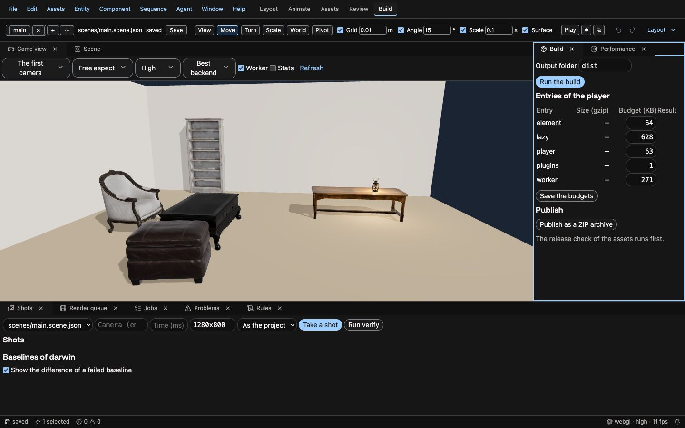

# Scenity Studio

Scenity Studio is the place to work on Scenity projects. One command starts it, and the browser shows the Hub: your
projects, the templates, the samples, the agents and the checks of this machine. A project opens in an editor window
with the scene, the panels, the jobs, version control and an agent that works beside you.



## Start it

```sh
scenity studio
```

The studio host starts on `127.0.0.1` (port 5170) and opens the browser on the Hub. The first line of the output is
`SCENITY_STUDIO_READY {"origin":…,"url":…}`; the URL is a launch link with a code that works once and signs this
browser in. A second `scenity studio` finds the running studio and opens the browser there. Ctrl+C in the terminal
stops the studio and each job that it started.

| Option            | What it does                                                                               |
| ----------------- | ------------------------------------------------------------------------------------------ |
| `--project <dir>` | Open this project in an editor window at once                                              |
| `--port <n>`      | Another port                                                                               |
| `--root <dir>`    | A folder that the folder dialogs show and that jobs can run in (more than one is possible) |
| `--state <dir>`   | Another state folder ([the files of the studio](#the-files-of-the-studio))                 |
| `--no-open`       | Print the launch link and open no browser                                                  |
| `--safe`          | Open each project in restricted mode ([trust](#trust-and-restricted-mode))                 |
| `--no-agent`      | No agent sessions; every other feature works                                               |

With no checkout, `bunx @scenity/cli studio` runs the studio in an empty folder. [cli.md](cli.md#scenity-studio) has
the details of the command.

A browser with no session of the studio gets a page that says to run `scenity studio`: open the launch link of the
output again, or run the command again.

## The Hub

The Hub has four sections on the left: **Projects**, **Learn**, **Agents** and **Settings**.

The first start shows **Welcome to Scenity Studio** in three steps: the look and the language, the connection of an
agent, and the check of this machine. **Skip** closes it; it does not come again.

### Projects

The list shows each project with its picture, its folder, the last open, the count of scenes and its state ("folder
not found", "newer format", "restricted"). Search, sort and the card or list view are at the top. A press on a card
opens the project. The menu of a card (**Actions for …**) has **Open**, **Open in a new window**, **Rename…**,
**Pin**, **Reveal on the disk**, **Trust this project**, **Save as a template…** and **Remove from the list** (the
folder stays on the disk). **Save as a template…** asks for a title and a description, and keeps a copy of the
project folder in `templates/<id>/` of the studio state, with no build outputs and no local state.

**New project** opens the new project dialog. With agents, its first field is **Describe what you want to make**:
**Start from the prompt** lets the agent choose a template and a name, makes the project, and opens the editor
window, where a new session (in review mode) builds a first scene from your words. Its changes wait for your review
(**Accept** or **Reject** in the Review panel). The other way:



1. Choose a template. **Empty** has a floor, a box, two lights and a camera. **Showroom** has six furniture models, an
   HDR sky and three scenes. The samples (Characters, Walkthrough, Road crossing, Physics, Spin plugin, glTF samples)
   need a Scenity checkout. Your templates (**Save as a template…**) and the templates of the plugins of the checkout
   come after them.
2. Type the **Name** (1 to 64 letters, digits, `-` and `_`) and choose the **Place** with **Choose…**.
3. Keep **Make a Git repository** on to start the project with Git.
4. In a checkout, **Scenity packages** links the packages of the checkout, or uses the published packages.
5. Press **Make**. A job makes the project and installs its packages; then the editor window opens. On an error,
   **Log** shows the output of the job and **Retry** runs it again.

Many projects can be open at once, each in its own tab. A project with no open window and no request for 30 minutes
closes, and its link (`/p/<key>`, or the Hub) opens it again: a scene with unsaved changes gives them back from the
drafts of the host.

**Open…** opens a folder dialog. **Open this project** opens a folder with `scenity.project.json`; **Make this folder
a project** writes a project file and a first scene into a plain folder. **Clone from Git…** clones a repository
(HTTPS or SSH) into a new folder and opens it.

### Learn, Agents and Settings

- **Learn** opens a copy of a sample in a folder that you choose (the sample never changes), and links the docs. Its
  box **Ask how to do something** answers a question with links to the sections of the docs that match its words,
  and with a tutorial when one matches. **Start in <project>** opens your last project with that tutorial. The box
  needs no agent: it searches the docs of this page.
- **Agents** shows the state of Claude, the command that connects each external agent (to copy), the connections
  (a request waits here too: pick its project, then **Allow** or **Deny**; **Revoke** takes the token of a client
  back), **Connect over HTTP**, the defaults of new sessions (the permission mode, the budget, and the permission of
  each kind of action), the recipes, and the use and the cost of the day.
- **Settings** has the theme, the language, the count of recent projects and **This machine**: the checks of Bun,
  Git, Blender, Chromium for pictures and Claude. A check that fails says what needs it and gives the fix, for
  example **Install Chromium** for the shots of the project.

## The editor window



The title bar has the menu bar (File, Edit, Assets, Entity, Component, Sequence, Agent, Window, Help) and the
**workspaces**: Layout, Animate, Assets, Review and Build. A workspace is a layout of the dock for one kind of work;
the **Layout** menu at the right of the toolbar saves your own layouts. Each panel can move, stack as a tab, float or
close; **Window** opens any panel.



**Search and ask** (⌘K) finds commands, entities, files, assets, settings and docs; a sentence goes to the agent
(⌘↩). F1 opens the docs of the panel under the pointer. **Help → Take the tour** shows the six main parts of the window
again; **Help → Tutorials** has three guided tutorials (your first scene, a prefab, a sequence): each step points at
its part of the window and goes on when you do it, and the card says when the tutorial is done. Ask the agent "show me
how" for any other task: it points at each control in turn, and you do the steps. The status bar shows the save state, the selection, the problems and the renderer; a press on an item opens
its panel.

[editor.md](editor.md) is the manual of the editor: each panel, the hierarchy, the inspector, the viewport, assets,
materials, prefabs, the sequencer, play mode, rules, settings and keys.

## Agents

The **Agent** panel holds the agent sessions of the project (⌘T for a new one). Type a request in the composer and
send it with ⌘↩. The context of the window goes with it as chips: the scene, the selection, the time, the camera of the
Scene view and the panel. A press on a chip takes it out; **Picture** and **A region of the Scene view** add a frame.

Each session has a **Mode**:

| Mode       | What the agent can do                                                                                      |
| ---------- | ---------------------------------------------------------------------------------------------------------- |
| **Ask**    | Read and explain. The edit tools refuse; jobs that only read can run                                       |
| **Review** | Each edit is a change set that waits in the **Review** panel: accept or reject each change, or all of them |
| **Auto**   | The edits apply at once, as one undo step each                                                             |

The agent works in its own view: the Scene view of the person keeps its camera, its time and its selection. **Follow
the agent** shows the last frame of the agent. **Undo the turn** puts back the files and the scene of a turn; the
checkpoint of each turn can come back too. An action that the permissions of the session or of the project do not
allow puts an approval card in the transcript. **Plan first** makes the agent propose a plan of steps before it
edits; **Approve**, **Edit** or **Deny** the plan. A session can have a budget in USD, a count of turns and a time.

Other ways to work with agents:

- The **Terminal** panel runs Claude Code (with the tools of the studio) or a shell in the project folder.
- An external agent (Claude Code, Codex, Cursor, Claude Desktop) connects with `scenity mcp`. The studio asks
  "… asks to work in this project as an agent"; **Allow** gives it a session with the same gate, presence and change
  sets. An MCP client over HTTP uses `http://127.0.0.1:<port>/mcp` with the header
  `Authorization: Bearer <token>`: Hub → Agents → **Connect over HTTP** makes the connection for a project and shows
  the token once, in the line for Claude Code
  (`claude mcp add --transport http scenity <url>/mcp --header "Authorization: Bearer <token>"`) and in the JSON of
  the other apps.
- **Agent → Recipes** has the recipes of the studio, of the person and of the project: a prompt with fields. In the
  Hub, **Agents** lists them: **New recipe** makes a recipe of your own (a title and a prompt; each `{name}` of the
  prompt is a field), **Change** and **Remove** change your recipes, and **Run in the project** opens the project
  that you choose with the recipe.
- The **Tasks** panel shows the background tasks of the agents; the **Instructions** panel shows and edits
  `AGENTS.md`, `CLAUDE.md` and the skills of the project, which each turn reads.

## Jobs, version control and plugins

- The **Jobs** panel shows each job of the studio and of the project (check, build, shots, the asset commands) with
  its log and its outputs, **Stop** and **Run again**, the runs of the project and the commands of its plugins.
- The **Version control** panel (⌘⇧G) shows the changed files with a semantic diff of each scene, commits the files
  that you pick, and changes the branch.
- The **Plugins** panel lists the plugins of the project with their faces, adds and removes a plugin, and makes a new
  plugin from a wizard. [plugins.md](plugins.md) is the guide to write one.

## Trust and restricted mode

A project with plugins or runs can run code on this machine. Until you trust it, it opens in **restricted mode**: a
bar says "Restricted mode: the plugins of this project do not run until you trust it", and its plugins and runs do
not start. **Trust this project…** (in the bar, or in the menu of its card in the Hub) trusts the folder and reloads
the window. `scenity studio --safe` opens each project in restricted mode.

## Roles, review links and remote mode

Each browser session of the studio has a role. The link of `scenity studio` gives the **owner** role. The owner can
make a link of another role (`POST /api/launch-code` with `{ "role": "editor" }` or `{ "role": "viewer" }`):

| Role     | Can                                                                            | Cannot                                                 |
| -------- | ------------------------------------------------------------------------------ | ------------------------------------------------------ |
| `admin`  | Everything (the owner)                                                         | In remote mode: a shell terminal                       |
| `editor` | Edit and save the scenes, the agent in the Ask and Review modes, the jobs      | The terminals, the trust, the links, the plugins, Auto |
| `viewer` | Look at the project and the agent sessions, and leave notes in the Notes panel | Any change                                             |

A control that a role cannot use stays in the window, off, and its tooltip gives the reason. A viewer window has a
bar that says so. **Share for review** on a turn of the Agent panel makes a review link: a viewer link that works for
7 days and opens the window with the session of the turn and the Notes panel.

**Remote mode** puts the studio on another machine (a server or a container). The host stays on 127.0.0.1 with
`scenity studio --public-origin https://studio.example.com`. The gateway of the studio runs as another user on the
public port:

```sh
SCENITY_STUDIO_PUBLIC_ORIGIN=https://studio.example.com SCENITY_PORT=8080 bun packages/studio-host/src/gateway.ts
```

The gateway passes only the requests for the public name (a TLS proxy in front of it must keep the `Host` header).
It refuses the host secret, which works only on the host machine. The links of the studio then have the public
origin, so a review link works on the machine of the reviewer. In remote mode the studio opens no shell terminal, and
each file write of an agent asks, in the Auto mode too.

## Preferences and languages

**Preferences** (**Window → Preferences**) has the editor settings, the theme, the layout, the key map,
the scene pool and the preferences of the studio: the language, the recent projects, autosave and the defaults of new
agent sessions. The studio speaks English (en-US) and Brazilian Portuguese (pt-BR). The **Usage log** setting keeps
a local log of the commands for a usability study; it is off by default, and the log never leaves this browser.

## The files of the studio

The state folder is `~/Library/Application Support/org.scenity.editor/studio` on macOS (`--state` changes it):

| File                | What it holds                                                     |
| ------------------- | ----------------------------------------------------------------- |
| `preferences.json`  | The preferences of the person                                     |
| `layouts.json`      | The saved layouts of the dock                                     |
| `keymap.json`       | The key map                                                       |
| `registry.json`     | The list of projects of the Hub                                   |
| `trust.json`        | The trusted project folders                                       |
| `recipes.json`      | The recipes of the person                                         |
| `agent-usage.json`  | The cost and the tokens of each day                               |
| `agent-tasks.json`  | The record of the background tasks                                |
| `worktrees/<task>/` | The Git worktree of a background task in a worktree               |
| `host.json`         | The secret of the tools and the hashes of the sessions (mode 600) |
| `templates/<id>/`   | A template of the person: a project folder and `template.json`    |

The project keeps its own files: `scenity.project.json`, `scenity.editor.json` (the project settings of the editor),
`AGENTS.md`, `.scenity/recipes/` and the drafts of autosave in `.scenity/`.

## When something goes wrong

- **The browser says that it has no session.** Run `scenity studio` again; it opens the browser with a new launch
  link.
- **The port is in use by another program.** Start the studio with `--port <n>`.
- **A project opens in restricted mode.** Trust it if you know where it comes from.
- **A shot or a picture fails.** Open **Settings → This machine** in the Hub and press **Install Chromium**.
- **The agent is not there.** **Settings → This machine** shows the state of Claude; the studio works with no agent.

The workbench page of older versions retires: its parts are in the studio ([workbench.md](workbench.md)).
